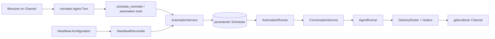
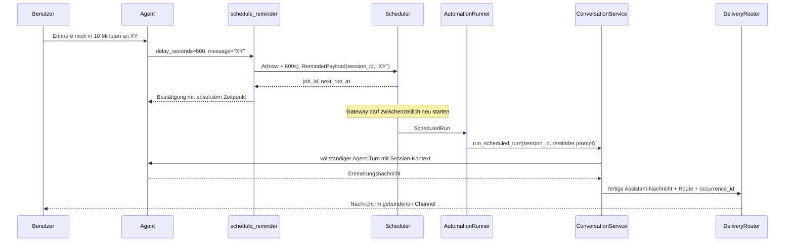

# Heartbeats und zeitversetzte Agent-Tasks im Gateway

Stand: 20. August 2026

## Kurzfassung

Cara sollte Heartbeats und Erinnerungen nicht als zwei getrennte Timer-Systeme
implementieren. Beide sind Automationen, die vom bereits im Gateway laufenden
`Scheduler` ausgelöst werden:

- Ein **Reminder** ist ein vom Benutzer angelegter, einmaliger Job. Beispiel:
  „Erinnere mich in zehn Minuten an die Wäsche.“
- Ein **Heartbeat** ist ein systemeigener, wiederkehrender Job. Er startet einen
  Agent-Turn mit einem engen Prüfauftrag. Nur wenn der Agent etwas Relevantes
  findet, wird eine Nachricht an den gebundenen Channel ausgeliefert.

Der Scheduler bestimmt nur, **wann** etwas fällig ist. Das Gateway bestimmt,
**welche Session** geweckt wird, **welchen Prompt** der Agent erhält und **wie**
das Ergebnis an den Channel zugestellt wird.

Die empfohlene Zielarchitektur ist:



Für den ersten vertikalen Schnitt genügt ein sessiongebundener Reminder mit
WebSocket-Zustellung. Für eine wirklich zuverlässige Benachrichtigung bei einem
zwischenzeitlich getrennten Client braucht Cara zusätzlich eine persistente
Delivery-Outbox oder einen direkten Outbound-Adapter des Channels.

## Begriffe und Abgrenzung

Ein Heartbeat in diesem Dokument ist **kein** WebSocket-Ping und kein
Health-Check des Prozesses. Er ist ein geplanter, vollständiger LLM-Turn, durch
den Cara proaktiv prüfen und gegebenenfalls sprechen kann.

Ein zeitversetzter Task besteht aus drei getrennten Phasen:

1. Der Agent legt während eines normalen Turns einen persistenten Job an.
2. Der Gateway-Scheduler erkennt später dessen Fälligkeit und startet Arbeit.
3. Das Resultat wird an die ursprünglich gebundene Session beziehungsweise
   deren Channel-Route ausgeliefert.

Diese Trennung ist wichtig: „Job wurde fällig“, „Agent-Turn war erfolgreich“
und „Nachricht wurde zugestellt“ sind drei unterschiedliche Zustände.

Nicht gemeint sind zunächst:

- unbeaufsichtigte Shell-Befehle oder beliebiger Code vom Scheduler;
- verteilte Scheduler-Ausführung auf mehreren Gateway-Instanzen;
- eine vollständige Workflow-Engine mit Abhängigkeiten zwischen Jobs;
- ein verstecktes Wiederverwenden alter Chat-Aufträge als vermeintliche
  Heartbeat-Checkliste.

## Wie OpenClaw es löst

OpenClaw behandelt einen Heartbeat als periodischen Agent-Turn in der
Hauptsession. Die Taktung gehört seinem Automations-Scheduler; pro
heartbeatfähigem Agent existiert ein systemeigener, persistenter
Heartbeat-Job. Es gibt keinen zweiten Fallback-Timer. Das ist die wichtigste
Idee, die Cara übernehmen sollte. Siehe die offizielle
[Heartbeat-Dokumentation](https://docs.openclaw.ai/gateway/heartbeat) und die
[Automations-Dokumentation](https://docs.openclaw.ai/automation/cron-jobs).

Weitere relevante Eigenschaften von OpenClaw:

- Automationen laufen im Gateway-Prozess, nicht „im Modell“.
- Ein Job besitzt einen Zeitplan, einen Payload und ein Session-Ziel.
- Heartbeat-Jobs sind systemeigen. Konfiguration ist der Sollzustand; beim
  Start beziehungsweise Reload wird dieser mit den persistenten Jobs
  abgeglichen.
- Ein Heartbeat verwendet einen engen Prompt. Antwortet das Modell nur mit
  `HEARTBEAT_OK`, wird keine Nachricht ausgeliefert.
- Ein Ziel kann beispielsweise die letzte Kontaktroute, ein expliziter Channel
  oder „keine Auslieferung“ sein. Account und konkreter Empfänger werden davon
  getrennt betrachtet.
- Active Hours, Busy Guards, Timeouts und eine Begrenzung paralleler Runs
  verhindern nächtliche, überlappende oder unkontrollierte Läufe.
- Einmalige Erinnerungen und wiederkehrende Aufgaben sind normale
  Automationen; eine Heartbeat-Notiz ist kein Ersatz für einen eigenen
  Zeitplan.
- Run-Historie und Skip-/Fehlergründe sind inspizierbar.

OpenClaw unterscheidet außerdem Payload-Arten. Ein System-Event kann eine
Session wecken, während eine Agent-Message direkt einen modellgestützten Turn
startet. Cara braucht am Anfang nicht alle Varianten. Ein typisierter
`agent_turn`-Payload mit den Unterarten `reminder` und `heartbeat` reicht.

Die öffentlich dokumentierten Busy-Regeln und einige Fehlerberichte im
OpenClaw-Projekt zeigen eine wichtige Falle: Ein Scheduler darf einen Run nicht
als erfolgreich verbuchen, nur weil ein Wake-up in eine flüchtige Queue gelegt
wurde. Der gebundene Prompt muss vom Agent-Turn tatsächlich übernommen worden
sein. Siehe beispielsweise die Diskussion zu
[verlorenem Cron-Payload](https://github.com/openclaw/openclaw/issues/73189).

### Was Cara davon übernehmen sollte

- eine einzige persistente Scheduling-Quelle;
- systemeigene, per Konfiguration abgeglichene Heartbeat-Jobs;
- explizite Session- und Delivery-Ziele;
- einen stillen Heartbeat-Acknowledge;
- Busy-Retry statt stillen Verwerfens;
- Run-Historie und strukturierte Gründe für `succeeded`, `skipped`, `retrying`
  und `failed`;
- serverseitige Bindung an die aktuelle Session, damit das Modell nicht frei
  an beliebige Channel-Adressen senden kann.

### Was Cara vorerst einfacher halten kann

- nur Main-/Current-Session statt OpenClaws zusätzlicher isolierter Sessions;
- nur `At`, `Interval` und später `Cron`, die das vorhandene Scheduler-Paket
  bereits unterstützt;
- keine Shell-, Script- oder Webhook-Payloads;
- für Heartbeats exakt `HEARTBEAT_OK` statt einer toleranten Normalisierung mit
  zusätzlichem Text;
- explizite Session-Ziele statt der semantisch komplizierteren Route `last`.

## Ist-Zustand in Cara

| Baustein | Heute vorhanden | Lücke |
| --- | --- | --- |
| Scheduler-Lifecycle | `gateway/lifespan.py` startet und stoppt `Scheduler[str]`. | Keine fachliche Automation-Komponente. |
| Persistenz | `SqliteJobStore` speichert Trigger, Payload und `next_run_at`. | Payload ist im Gateway nur ein String; keine Run-Historie. |
| Trigger | `At`, `Interval`, `Cron` inklusive Zeitzone. | Keine Gateway-RPCs oder Agent-Tools zum Verwalten. |
| Runner | `_log_job_run` protokolliert den Payload. | Kein Agent-Turn und keine Zustellung. |
| Sessions | `ConversationService.start_turn()` sperrt eine Session atomar und startet den Agenten. | Die Methode kehrt zurück, bevor der Turn abgeschlossen ist. |
| Session-Route | `ChannelRef(name, account_id)` wird persistiert. | Kein konkretes Konversations-/Empfängerziel. |
| Live-Events | `InMemoryEventBroker` sendet Events an aktive WebSocket-Subscriber. | Getrennte Clients verlieren Ereignisse; keine Outbox und kein Channel-Sender. |
| Agent-Erweiterung | Der Cara-Agent baut seine Tools über `build_tools()`. | Das Plugin erhält noch keinen Automation-Port vom Gateway. |

Die aktuelle Scheduler-Implementierung hat bereits nützliche Semantik:

- Überfällige `At`-Jobs laufen nach einem Neustart sofort.
- Wiederkehrende Jobs überspringen verpasste Ticks, anstatt sie gesammelt
  nachzuholen.
- Derselbe wiederkehrende Job überlappt nicht mit sich selbst.
- Ein Runner-Fehler beendet spätere Intervall-/Cron-Runs nicht.
- SQLite ergibt bei einem Prozessabsturz während eines Runs eine
  At-least-once-Tendenz.

Für Erinnerungen gibt es aber zwei kritische Details:

1. `_dispatch()` fängt Runner-Fehler ab. Ein `At`-Job wird anschließend trotzdem
   entfernt. Ein Busy- oder Delivery-Fehler könnte die Erinnerung daher
   endgültig verlieren.
2. `ConversationService.start_turn()` bestätigt lediglich die Annahme und
   startet eine Background-Task. Der Scheduler könnte den Job bereits löschen,
   obwohl der eigentliche Turn später fehlschlägt.

Vor einer produktiven Reminder-Funktion muss der Gateway-Runner deshalb bis zu
einem fachlichen Endzustand warten oder einen persistenten Run erzeugen, dessen
Worker den Turn zuverlässig weiterverarbeitet.

## Empfohlenes fachliches Modell

### Automation-Job

Das generische `scheduler`-Paket bleibt für Zeitberechnung und Wake-up
verantwortlich. Sein Gateway-Payload wird zu einem versionierten Envelope, der
Ausführungsziel und fachlichen Payload ausdrücklich trennt:

```python
@dataclass(frozen=True, slots=True)
class SessionAutomationTarget:
    kind: Literal["session"]
    session_id: UUID


@dataclass(frozen=True, slots=True)
class ReminderPayload:
    kind: Literal["reminder"]
    message: str
    created_from_turn_id: UUID


@dataclass(frozen=True, slots=True)
class HeartbeatPayload:
    kind: Literal["heartbeat"]
    prompt: str
    heartbeat_id: str


type AutomationPayload = ReminderPayload | HeartbeatPayload


@dataclass(frozen=True, slots=True)
class AutomationEnvelope:
    schema_version: Literal[1]
    target: SessionAutomationTarget
    payload: AutomationPayload
```

`schema_version` ist erforderlich, weil die SQLite-Jobs Gateway-Releases
überleben. Der JSON-Codec muss bei unbekannten Versionen hart und sichtbar
fehlschlagen, nicht raten.

In V1 ist nur `SessionAutomationTarget` implementiert. Das bedeutet nicht,
dass jede Automation grundsätzlich einer Session gehören muss: Das Target
bestimmt den Ausführungskontext, während Besitz und spätere Zustellung eigene
Konzepte bleiben. Die `session_id` wird vom Gateway gesetzt und die Route bei
Ausführung serverseitig aus dieser Session ermittelt. Damit kann ein
kompromittierter oder halluzinierender Tool-Call nicht einfach eine fremde
Telefonnummer oder Channel-ID einsetzen. Spätere Targets wie `isolated` oder
eine Agent-Main-Session können ergänzt werden, ohne die Reminder-Daten zu
verändern.

### Reminder

Ein Reminder ist ein `At`-Job. Für
„Erinnere mich in zehn Minuten an XY“ ist der Ablauf:



Der Agent erhält keinen bloßen Text „XY“, sondern einen vom Gateway gerenderten
Trigger-Prompt, zum Beispiel:

```text
[Scheduled reminder]
This reminder is now due. Remind the user about: XY
Do not reschedule it unless the user explicitly asks in a later turn.
```

Der Benutzerinhalt wird dabei als Datenfeld behandelt und nicht als
Gateway-Instruktion. Der fertige Run erhält Metadaten wie:

```json
{
  "origin": "automation",
  "automation_kind": "reminder",
  "job_id": "...",
  "scheduled_for": "2026-08-20T14:10:00Z",
  "occurrence_id": "..."
}
```

### Heartbeat

Ein Heartbeat ist ein `Interval`- oder `Cron`-Job. Er wird nicht durch das
Modell angelegt, sondern ist systemeigen und wird aus der Gateway-Konfiguration
abgeglichen.

Der Heartbeat-Prompt soll absichtlich eng sein, zum Beispiel:

```text
This is a heartbeat turn. Check only the configured heartbeat instructions and
the current session context. If something requires the user's attention, reply
with that message. If nothing requires attention, reply exactly HEARTBEAT_OK.
Do not recreate scheduled tasks from old conversation messages.
```

Antwortet der Agent exakt `HEARTBEAT_OK`, gilt der Run als erfolgreich und
still:

- kein Outbound-Versand;
- kein `chat.delta` an normale Channel-Clients;
- Run-Historie mit `outcome=silent`;
- idealerweise kein dauerhaftes Verschmutzen des normalen Chatverlaufs durch
  Poll und Acknowledge.

Da der heutige `ConversationService` Deltas sofort publiziert, muss der
Heartbeat-Pfad seine Ausgabe bis `ChatCompleted` puffern. Erst dann steht fest,
ob die vollständige Antwort `HEARTBEAT_OK` ist. Eine bereits gestreamte
Bestätigung kann nachträglich nicht mehr „ungesendet“ werden. Normale und
Reminder-Turns können weiterhin streamen.

Antwortet er mit echtem Inhalt, wird dieser wie eine proaktive
Assistant-Nachricht an die gebundene Route ausgeliefert.

### Systemeigene Heartbeat-Jobs abgleichen

Ein `HeartbeatReconciler` läuft vor `scheduler.start()` und bei einem späteren
Config-Reload:

1. Konfiguration validieren.
2. Für jeden aktivierten Heartbeat eine stabile Job-ID bilden, zum Beispiel
   `system:heartbeat:<heartbeat-id>`.
3. Fehlenden Job anlegen.
4. Trigger oder Payload eines bestehenden Jobs aktualisieren, wenn sich die
   Konfiguration geändert hat.
5. Deaktivierte systemeigene Jobs entfernen oder deaktivieren.
6. Niemals benutzererzeugte Jobs verändern.

Dafür braucht das Scheduler-Paket noch eine öffentliche `get/list/update`-
Verwaltung oder eine atomare `upsert`-Operation. Direkte Zugriffe des Gateway
auf private Store-Details wären die falsche Schicht.

Eine mögliche Konfiguration:

```yaml
automations:
  database: ./scheduler.sqlite3
  enabled: true
  busy_retry_seconds: 30
  max_busy_retries: 20

  heartbeats:
    - id: personal-check
      enabled: true
      every: 30m
      session_id: 00000000-0000-0000-0000-000000000000
      active_hours:
        start: "08:00"
        end: "22:00"
        timezone: Europe/Berlin
      prompt: >-
        Check the configured heartbeat instructions. If nothing needs
        attention, reply exactly HEARTBEAT_OK.
```

Die feste `session_id` ist für V1 eindeutig und sicher, aber operativ
unbequem. Später kann ein konfigurierbares Ziel wie
`latest_session_for_route` hinzukommen. Dafür muss die Route zunächst korrekt
modelliert sein.

## Session- und Channel-Zustellung

### Aktuelle Grenze

Der Gateway-Broker ist prozesslokal. Er liefert `session.event` nur an
WebSocket-Verbindungen, die zum Ausführungszeitpunkt verbunden und explizit auf
die Session subscribed sind. Das reicht für einen dauerhaft verbundenen
Voice-Client, aber nicht für eine garantierte Erinnerung nach einem
Client-Neustart.

Außerdem identifiziert `ChannelRef(name, account_id)` nur einen Channel-Account.
Bei Telegram, Discord oder WhatsApp können unter demselben Account mehrere
Gespräche existieren. Eine proaktive Nachricht braucht zusätzlich das konkrete
Ziel.

Empfohlene Erweiterung:

```python
@dataclass(frozen=True, slots=True)
class ChannelRef:
    name: str
    account_id: str | None = None
    conversation_id: str | None = None
```

Alternativ kann ein eigener `DeliveryRoute`-Typ verwendet werden. Entscheidend
ist, dass `conversation_id` eine opaque, vom Channel-Adapter gelieferte ID ist
und nicht vom LLM erfunden wird. Die Erweiterung betrifft Domainmodell,
SQLModel, Alembic-Migration, RPC-Schemas, Mapping, OpenRPC-Schema und den
generierten `gateway_client`.

### Zustellstufen

**V1 – Live-Client:** Der fällige Turn publiziert die vorhandenen
`session.event`-Events. Ein verbundener Client spricht beziehungsweise zeigt
die Assistant-Nachricht an.

**V2 – Zuverlässige Zustellung:** Eine persistente Outbox speichert die fertige
Nachricht und ihren Delivery-Zustand in derselben Transaktion wie das
Turn-Ergebnis. Ein Worker sendet sie über einen registrierten Channel-Adapter:

```python
class ChannelSender(Protocol):
    async def send(
        self,
        route: ChannelRef,
        message: str,
        *,
        idempotency_key: str,
    ) -> None: ...
```

`idempotency_key` basiert auf `occurrence_id` und Nachrichtenposition. Ein
erneuter Versuch nach einem Prozessabsturz erzeugt dadurch möglichst keine
doppelte Erinnerung. Wenn der Channel keine native Idempotenz unterstützt,
reduziert die lokale Outbox Duplikate, kann sie aber nicht in allen
Netzwerkfehlerfällen vollständig ausschließen.

Ein reconnectender WebSocket-Client braucht entweder ebenfalls einen Outbox-
Consumer oder eine RPC wie `session.events_since(sequence)`. Der heutige
In-Memory-Broker allein kann verpasste Events nicht nachliefern.

## Gateway-Komponenten

### `AutomationService`

Anwendungsschicht für:

- Reminder anlegen;
- Jobs auflisten und abbrechen;
- systemeigene Heartbeats abgleichen;
- Eingaben und Besitzverhältnisse prüfen;
- absolute Antwortzeiten und Job-IDs zurückgeben.

Nur diese Schicht darf fachliche Payloads in den generischen Scheduler geben.

### `AutomationRunner`

Übersetzt `ScheduledRun[AutomationPayload]` in Gateway-Verhalten:

- Session laden;
- Active Hours und Busy-Zustand prüfen;
- Run-Historie mit eindeutiger `occurrence_id` beginnen;
- typabhängigen Prompt rendern;
- Agent-Turn bis zum terminalen Zustand ausführen;
- Heartbeat-Acknowledge normalisieren;
- Zustellung anstoßen;
- Erfolg, stillen Erfolg, Retry oder Fehler persistieren.

### Awaitbarer geplanter Turn

`ConversationService.start_turn()` soll für RPC-Clients weiterhin schnell
antworten können. Für Automationen braucht es jedoch einen awaitbaren Pfad. Eine
mögliche Aufteilung:

```python
async def start_turn(...) -> None:
    # claim + Background-Task für interaktive RPC-Aufrufe

async def run_turn(...) -> TurnResult:
    # claim + tatsächliche Ausführung bis completed/failed/cancelled
```

Beide Pfade müssen dieselbe private Turn-Ausführung verwenden; die
Agent- und Persistenzlogik darf nicht dupliziert werden. `TurnResult` enthält
mindestens Status, fertigen Assistant-Text und die IDs der erzeugten Einträge.

### Geplanter Trigger ist keine Benutzernachricht

Die heutige Turn-Ausführung beginnt immer mit `Session.add_user_message(text)`.
Das ist für echte Eingaben richtig, für einen Gateway-Trigger aber semantisch
falsch. Würde der Heartbeat diesen Pfad unverändert verwenden, sähe der Agent
bei jedem Tick eine künstliche User-Nachricht und der Session-Verlauf wüchse
dauerhaft.

Der gemeinsame Ausführungskern braucht deshalb einen expliziten Input-Typ, zum
Beispiel:

```python
type TurnInput = UserTurnInput | AutomationTurnInput
```

Ein `UserTurnInput` wird wie heute als User-Entry persistiert. Ein
`AutomationTurnInput` trägt `kind`, `job_id`, `occurrence_id` und den gerenderten
Trigger-Prompt. Für V1 kann dieser Input nur für den aktuellen LLM-Request in
den Kontext eingefügt und ausschließlich in der Automation-Run-Historie
gespeichert werden. Wird später eine vollständige Audit-Timeline gewünscht,
sollte dafür ein eigener `SystemEvent`-/`AutomationTrigger`-Entry eingeführt
werden, nicht ein als Benutzer getarnter Eintrag.

Bei einem Reminder wird nur die echte Assistant-Antwort in der sichtbaren
Session gespeichert. Bei einem stillen Heartbeat werden weder Trigger noch
`HEARTBEAT_OK` als normale Chat-Einträge gespeichert.

### Agent-Tool-Anbindung

Das Agent-Paket soll das konkrete `scheduler`-Paket nicht importieren. Das
`agent_plugin_api` erhält stattdessen einen schmalen Gateway-Port, beispielsweise
`AgentAutomationCommands`, über den das Plugin sessiongebundene Jobs verwalten
kann. Der Cara-Agent injiziert diesen Port in `ToolContext`.

Im aktuellen Code ruft `_CaraAgentRunner.run()` zwar mit einem
`AgentRunRequest` auf, übergibt an `_ConfiguredAgentFactory` aber nur den daraus
gelesenen `AgentContext`. Beim Bau der Tools sind `session_id` und `turn_id`
damit nicht mehr verfügbar. Die Factory-Signatur muss turn-spezifisch werden,
etwa `factory(request, context)`, oder einen expliziten `AgentTurnContext` in
den `ToolContext` injizieren. Nur so kann das Scheduling-Tool die serverseitig
vorgegebene Session verwenden, ohne sie als unsicheres LLM-Argument
entgegenzunehmen.

V1-Tools:

```text
schedule_reminder(message, delay_seconds | run_at, timezone?)
list_reminders()
cancel_reminder(job_id)
```

Regeln für `schedule_reminder`:

- Genau eine Zeitform ist erlaubt.
- `delay_seconds` verhindert unnötige Datumsarithmetik für „in zehn Minuten“.
- `run_at` muss ISO 8601 mit Offset enthalten; eine naive Zeit wird abgelehnt.
- Die aktuelle `session_id` und Route kommen aus dem Turn-Kontext, nicht aus
  Tool-Argumenten.
- Das Ergebnis enthält Job-ID und absoluten lokalen sowie UTC-Zeitpunkt. Der
  Agent kann dadurch eindeutig bestätigen: „Ich erinnere dich um 16:10 Uhr.“
- Sinnvolle Obergrenzen für Textlänge, minimale Verzögerung und maximale Anzahl
  aktiver Jobs pro Session werden serverseitig geprüft.

Später können `schedule_recurring_task`, `list_automations` und
`cancel_automation` folgen. Heartbeat-Systemjobs bleiben für das Modell
schreibgeschützt.

### Dependency Injection ohne Schichtverletzung

Es entsteht leicht ein Kreis:

```text
ConversationService -> AgentRunner -> AutomationCommands -> Scheduler
Scheduler -> AutomationRunner -> ConversationService
```

Dieser Kreis darf nicht durch globale Variablen oder defensive
`getattr`-Aufrufe kaschiert werden. Der Composition Root sollte einen
`AutomationCoordinator` in zwei Phasen verdrahten oder Scheduling-Commands und
Run-Ausführung über einen expliziten Port entkoppeln. Eine praktikable Variante:

1. Store, `AutomationCommands` und einen expliziten Runner-Bridge-Port bauen.
2. Agent-Plugin und `ConversationService` mit den Command-Ports bauen.
3. `AutomationRunner` an die Bridge binden.
4. Erst danach in `lifespan` den Scheduler starten.

Die Bridge muss vor dem Start gebunden sein und bei einem ungebundenen Aufruf
hart fehlschlagen. Noch sauberer ist mittelfristig eine persistente
`automation_runs`-Inbox: Der Scheduler schreibt einen fälligen Run atomar, und
ein separater Worker verarbeitet ihn. Dann ist die Entkopplung zugleich
absturzsicher.

## Ausführungs- und Fehlersicherheit

### Empfohlene Zustände

Für jeden fälligen Zeitpunkt sollte eine Run-Zeile existieren:

```text
pending -> running -> succeeded
                   -> silent
                   -> retrying -> running
                   -> failed
                   -> skipped
```

Nützliche Felder:

- `occurrence_id` als eindeutiger Schlüssel aus Job und geplantem Zeitpunkt;
- `job_id`, `scheduled_for`, `started_at`, `finished_at`;
- `attempt`, `status`, `reason`, `error`;
- `session_id`, `turn_id` und optional `delivery_id`;
- Token-/Laufzeitmetriken, sobald der Agent diese liefert.

### Busy-Verhalten

Die vorhandene atomare `claim_turn`-Operation ist der richtige Guard. Ein
fälliger Reminder darf bei `SessionBusyError` aber nicht als erledigt gelten.

Empfehlung:

- Reminder: mit begrenztem Backoff erneut versuchen, bis der Turn angenommen
  wurde; nach Erschöpfung sichtbar `failed` und eine Failure-Notification
  erzeugen.
- Heartbeat: bei Busy überspringen oder bis zu einer kleinen Cooldown-Grenze
  verschieben; keine Heartbeat-Warteschlange aufstauen.
- Wiederkehrende Jobs: verpasste Intervalle nicht gesammelt nachholen.

Damit unterscheiden sich zuverlässige Erinnerungen bewusst von best-effort
Heartbeats.

### Prozessabsturz und Duplikate

Der bestehende Scheduler persistiert `next_run_at` erst nach Rückkehr des
Runners. Ein Absturz während der Ausführung macht denselben Zeitpunkt nach dem
Neustart erneut fällig. Das ist für Erinnerungen besser als Verlust, verlangt
aber Idempotenz.

`occurrence_id = hash(job_id, scheduled_for)` sollte daher an Turn,
Run-Historie und Delivery weitergereicht werden. Vor der Ausführung wird
geprüft, ob diese Occurrence bereits terminal erfolgreich ist.

### Active Hours

Active Hours werden in einer IANA-Zeitzone geprüft. Das Intervall ist
`start` inklusive und `end` exklusive. Für Heartbeats wird außerhalb des
Fensters der Tick übersprungen. Ein Benutzer-Reminder muss dagegen grundsätzlich
zum gewünschten Zeitpunkt laufen; Quiet Hours dürfen ihn nur dann verschieben,
wenn der Benutzer das ausdrücklich konfiguriert hat.

### Shutdown

Beim Gateway-Shutdown:

1. keine neuen Scheduler-Runs mehr annehmen;
2. aktive Automation-Runs mit einer kurzen Grace Period auslaufen lassen;
3. danach Tasks abbrechen;
4. nicht terminale persistente Runs so belassen, dass sie beim Neustart
   wieder aufgenommen werden;
5. erst anschließend Agent und DI-Container schließen.

## Persistenzentscheidung

Aktuell verwendet der Scheduler eine eigene SQLite-Datei, während Sessions in
der Gateway-Datenbank liegen. Das funktioniert für den ersten Schnitt, erlaubt
aber keine atomare Transaktion über Run, Assistant-Nachricht und Delivery-Outbox.

Zwei mögliche Wege:

1. **Kurzfristig:** Scheduler-SQLite behalten, `AutomationPayload` per JSON
   codieren und Run-Historie in derselben Scheduler-Datei ergänzen. Einfacher,
   aber nur bestmögliche Konsistenz zwischen zwei Datenbanken.
2. **Robustes Ziel:** Einen `JobStore`-Adapter auf der Gateway-Datenbank bauen
   und Jobs, Runs und Outbox gemeinsam verwalten. Dadurch lassen sich
   Zustandsübergänge und Idempotenz sauber transaktional sichern.

Empfehlung: V1 darf die bestehende Datei nutzen, solange die Semantik offen als
at-least-once dokumentiert und mit `occurrence_id` abgesichert ist. Vor externen
Channels und wichtigen Erinnerungen sollte der robuste Zielzustand umgesetzt
werden.

Die Migrationen `0005_scheduled_jobs.py` und `0006_remove_scheduled_jobs.py`
zeigen, dass eine Gateway-Tabelle bereits kurz existierte und wieder entfernt
wurde. Sie sollte nicht reaktiviert werden. Eine neue Migration muss das heute
gültige, typisierte Modell abbilden.

## RPC- und Administrationsoberfläche

Zusätzlich zu Agent-Tools sind Gateway-RPCs sinnvoll, damit CLI und Tests nicht
über das LLM gehen müssen:

```text
automation.create
automation.list
automation.get
automation.cancel
automation.runs
heartbeat.run_now
```

`automation.create` akzeptiert in V1 nur sichere Agent-Turn-Payloads und ein
Session-Ziel. Es akzeptiert keine Shell-Befehle. Alle Schemas verwenden wie die
übrige Gateway-API `extra="forbid"`.

Die RPC-Methoden brauchen Besitzprüfung: Ein Channel-Client darf nur Jobs seiner
eigenen Session beziehungsweise Route sehen oder ändern. Eine bloße Kenntnis
einer UUID darf keine fremde Zustellung ermöglichen.

## Konkreter Implementierungsplan

### Phase 1: Durchgängiger One-shot-Reminder

1. `AutomationPayload` und versionierten JSON-Codec im Gateway einführen.
2. `Scheduler[str]` durch `Scheduler[AutomationPayload]` ersetzen und
   `_log_job_run` entfernen.
3. `AutomationService` und `AutomationRunner` ergänzen.
4. Gemeinsame Turn-Ausführung so refaktorieren, dass geplante Runs auf den
   terminalen Turn-Zustand warten können.
5. `AgentAutomationCommands` in `agent_plugin_api` ergänzen und in das
   Cara-Toolset injizieren.
6. `schedule_reminder`, `list_reminders`, `cancel_reminder` implementieren.
7. Reminder-Ausgabe über bestehende `session.event`-Subscriptions ausliefern.
8. Job- und Occurrence-IDs strukturiert loggen.

Akzeptanzkriterium:

> Ein Benutzer schreibt in einer geöffneten und abonnierten Session
> „Erinnere mich in zehn Minuten an XY“. Das Tool legt einen persistenten
> `At`-Job an. Nach einem Gateway-Neustart innerhalb dieser zehn Minuten wird
> derselbe Session-Kontext geweckt und die Erinnerung genau einmal im noch
> verbundenen Client ausgegeben; bei Busy wird sie nicht verworfen.

„Genau einmal“ gilt in dieser Phase innerhalb eines normalen Prozesslaufs. Über
einen Absturz exakt während der Auslieferung bleibt die Semantik at-least-once.

### Phase 2: Heartbeat

1. Heartbeat-Konfiguration und Validierung ergänzen.
2. `HeartbeatReconciler` mit stabilen systemeigenen Job-IDs implementieren.
3. Active Hours, Busy-Skip und Timeout ergänzen.
4. `HEARTBEAT_OK` vor normaler Channel-Auslieferung auswerten.
5. `heartbeat.run_now` und Status-/Run-Inspektion ergänzen.
6. Sicherstellen, dass stille Polls den normalen Chatverlauf nicht aufblähen.

Akzeptanzkriterium:

> Ein konfigurierter Heartbeat überlebt einen Neustart, läuft nur in den
> Active Hours, erzeugt bei `HEARTBEAT_OK` keine Channel-Nachricht und liefert
> einen echten Hinweis als Assistant-Nachricht an die konfigurierte Session.

### Phase 3: Echte proaktive Channel-Zustellung

1. `conversation_id` beziehungsweise `DeliveryRoute` einführen und migrieren.
2. Outbound-Channel-Port und Adapter-Registry definieren.
3. Persistente Delivery-Outbox und Retry-Worker ergänzen.
4. WebSocket-Replay oder einen Outbox-Consumer für reconnectende Clients
   ergänzen.
5. Idempotenz und Dead-Letter-/Failure-Inspektion implementieren.

### Phase 4: Bedienbarkeit und Betrieb

1. RPCs und Client-Code generieren.
2. CLI für list/get/cancel/run-history ergänzen.
3. Metriken, strukturierte Logs und Health-/Readiness-Informationen ergänzen.
4. Optional wiederkehrende benutzerdefinierte Agent-Tasks freigeben.
5. Erst danach weitere Payloads wie Webhooks prüfen; unbeaufsichtigte
   Shell-/Script-Ausführung bleibt eine separate Sicherheitsentscheidung.

## Tests

Mindestens folgende Fälle sollten automatisiert werden:

### Scheduler und Codec

- Round-trip aller Payload-Versionen durch SQLite;
- unbekannte `kind` oder `schema_version` wird sichtbar abgelehnt;
- überfälliger Reminder läuft nach Neustart;
- wiederkehrender Heartbeat überlappt nicht mit sich selbst;
- DST-Wechsel und IANA-Zeitzone für Cron/Active Hours;
- Config-Reconciliation ist idempotent.

### Reminder

- „in zehn Minuten“ erzeugt `delay_seconds=600` und korrekten UTC-Zeitpunkt;
- absolute Zeit ohne Offset wird abgelehnt;
- Job ist an die aufrufende Session gebunden;
- Tool kann keine fremde Route injizieren;
- Cancel verhindert den späteren Turn;
- Busy führt zu Retry statt Jobverlust;
- Agent-Fehler und Delivery-Fehler erscheinen getrennt in der Run-Historie;
- dieselbe `occurrence_id` erzeugt keine zweite erfolgreiche Delivery.

### Heartbeat

- `HEARTBEAT_OK` ist erfolgreich, aber still;
- anderer Text wird ausgeliefert;
- Busy überspringt oder verschiebt gemäß Policy;
- außerhalb Active Hours kein Agent-Aufruf;
- deaktivierter Heartbeat besitzt keinen laufenden Tick;
- manuelles `run_now` ist von der normalen Taktung unterscheidbar;
- Heartbeat-Prompt übernimmt keine alten Chat-Aufträge als neue Schedules.

### Channel

- aktiver Subscriber empfängt die proaktive Nachricht;
- getrennter Client verliert in V2 nichts und erhält die Nachricht nach
  Wiederverbindung;
- mehrere Konversationen desselben Channel-Accounts werden nicht vermischt;
- Sender-Retry verwendet denselben Idempotency-Key.

## Beobachtbarkeit

Jeder Logeintrag eines geplanten Runs sollte mindestens enthalten:

```text
job_id, occurrence_id, kind, session_id, scheduled_for, attempt,
run_status, skip_reason, delivery_status, duration_ms
```

Sinnvolle Metriken:

- `automation_runs_total{kind,status}`;
- `automation_run_delay_seconds{kind}`;
- `automation_run_duration_seconds{kind}`;
- `automation_delivery_attempts_total{channel,status}`;
- `automation_jobs_active{kind}`.

Ein Readiness-Check soll melden, wenn Automationen konfiguriert sind, der
Scheduler aber nicht läuft oder seine SQLite-Datei nicht geöffnet werden kann.

## Offene Entscheidungen

Vor Phase 2 beziehungsweise 3 müssen folgende Produktentscheidungen explizit
getroffen werden:

1. Werden Heartbeats an eine feste Session, an die jeweils letzte Session
   einer Route oder an eine eigene isolierte Session gebunden?
2. Sollen Heartbeat-Turns im sichtbaren Chatverlauf persistiert werden? Die
   Empfehlung ist: nur echte, ausgelieferte Hinweise sichtbar machen; stille
   Polls ausschließlich in der Run-Historie halten.
3. Reicht für Voice ein dauerhaft verbundener WebSocket oder muss auch Voice
   nach einem Disconnect verpasste Erinnerungen nachholen?
4. Soll ein Reminder ohne LLM direkt als deterministische Nachricht ausgeliefert
   werden können? Das wäre billiger und zuverlässiger; ein LLM-Turn ist nur
   nötig, wenn Kontext oder Formulierung gewünscht ist.
5. Bleibt die separate Scheduler-SQLite bestehen oder wird vor externen
   Channels auf einen transaktionalen Gateway-Store migriert?

Für den angefragten Use Case ist die empfohlene V1-Antwort:

- Reminder laufen als modellgestützter Turn in derselben Session;
- Heartbeats sind systemeigene Jobs derselben Scheduling-Infrastruktur;
- Ziele sind zunächst feste Session-IDs;
- Live-Zustellung erfolgt über die vorhandenen Session-Events;
- Busy-Retry und Occurrence-Idempotenz werden bereits in V1 berücksichtigt;
- durable Outbound-Zustellung folgt als eigener, klar abgegrenzter Ausbau.

## Quellen

- [OpenClaw: Heartbeat](https://docs.openclaw.ai/gateway/heartbeat)
- [OpenClaw: Automations](https://docs.openclaw.ai/automation/cron-jobs)
- [OpenClaw: System CLI und manuelles Wake-up](https://docs.openclaw.ai/cli/system)
- [OpenClaw-Quellcode: Heartbeat-Anweisungen im System-Prompt](https://github.com/openclaw/openclaw/blob/main/src/agents/system-prompt.ts)
- [Cara-Scheduler-Dokumentation](scheduler/README.md)
- [Cara-Gateway-Protokoll](gateway/PROTOCOL.md)
