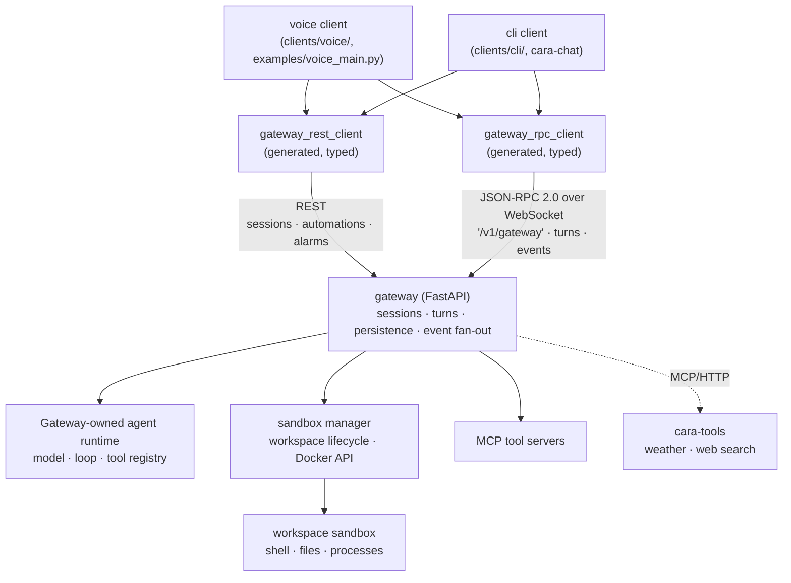
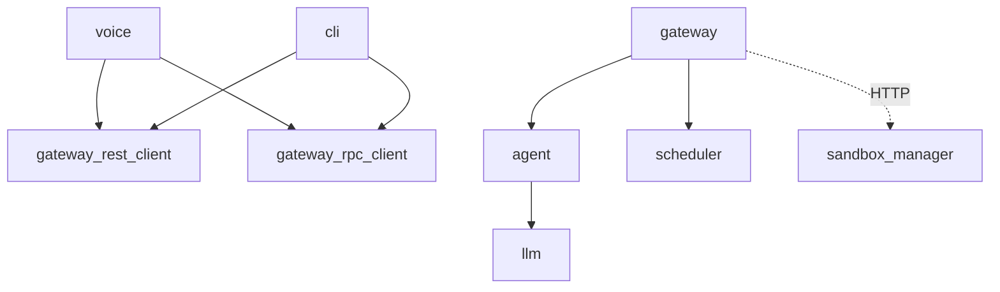

# Cara

Cara is an attempt at building a Jarvis-like presence: an agent you talk to naturally, with
low-latency, interruptible voice conversations, that follows you across machines instead of living
inside one chat window. A central gateway owns all conversation state over one JSON-RPC WebSocket;
a wake-word-driven voice client and a terminal client are both just thin clients of it, so a
conversation started by voice can be picked up from the terminal and back.

The voice pipeline puts particular emphasis on feeling immediate rather than following the classic
"record until silence, then transcribe, then synthesize" pattern — speech-to-text and text-to-speech
are both streamed, and barge-in plus acoustic echo cancellation let you interrupt Cara mid-sentence.
Ambient side effects (currently Philips Hue lighting reacting to listening/processing/speaking) make
the assistant felt, not just heard. See [Architecture](#architecture) below and the
[`voice`](clients/voice#readme) package for how that's actually built.

This is a learning project built to understand, hands-on, how an agent-gateway architecture like
[OpenClaw's](https://github.com/openclaw/openclaw) actually works — several concepts here (session
keys and database-first sessions) are deliberately adapted from it rather
than invented from scratch.

## Table of contents

- [Architecture](#architecture)
- [Packages](#packages)
- [Run](#run)
- [Workspace and Docker binds](#workspace-and-docker-binds)
- [Device discovery](#device-discovery)
- [Audio outputs](#audio-outputs)
- [Tool safety](#tool-safety)

## Architecture



Three ideas hold this together:

- **The gateway is the only owner of conversation state.** Sessions, turns, message history, and
  tool-call records live in the gateway's database. Clients never hold history themselves — they
  send new input against a session id and receive streamed events back. See
  [`gateway-server`](gateway#readme) for the session/turn lifecycle in full.
- **The wire protocol is generated from code, not hand-maintained.** Resources are REST routes and
  live-conversation commands are JSON-RPC methods ([why the split](docs/gateway-transport.md)).
  `cara-gateway-schema` renders both into `gateway/schema/openapi.json` and
  `gateway/schema/gateway.openrpc.json`, from which
  [`gateway_rest_client`](generated/gateway_rest_client#readme) and
  [`gateway_rpc_client`](generated/gateway_rpc_client#readme) are generated by
  `scripts/codegen/generate_gateway_clients.sh`. Never edit generated files by hand; CI fails on
  drift.
- **The gateway owns the agent runtime.** The model/tool loop is composed directly in the Gateway;
  arbitrary Python plugins are never loaded into that privileged process. Shell and workspace
  operations go through the separately deployed Sandbox Manager, while user integrations are
  out-of-process [MCP tool servers](docs/mcp-tools.md).

[`voice`](clients/voice#readme) and [`cli`](clients/cli#readme) are both thin clients built on the
generated gateway clients: neither talks to an LLM directly, and both get session-per-channel reuse
(`POST /v1/sessions/open`) for free from the gateway.

## Packages

All packages are members of one `uv` workspace (`pyproject.toml`). The Gateway,
Sandbox Manager, agent library, and generated client remain independently testable workspace
members. Their relevant runtime dependency graph is:



| Package                                       | What it is                                                                                     |
| --------------------------------------------- | ---------------------------------------------------------------------------------------------- |
| [`gateway-server`](gateway#readme)     | FastAPI process: protocol, sessions, persistence, agent runtime, and tool composition. |
| [`agent`](agent#readme)                       | Generic model-facing loop, context assembly, tool extension API, and middleware. |
| [`cara-tools`](cara-tools)                     | Out-of-process MCP host for information tools such as weather and web search. |
| [`sandbox-manager`](sandbox_manager)          | Workspace-scoped Docker lifecycle and remote shell/filesystem API. |
| [`gateway-rest-client`](generated/gateway_rest_client#readme) | Generated, fully typed client for the gateway's REST resources (sessions, automations, alarms). |
| [`gateway-rpc-client`](generated/gateway_rpc_client#readme) | Generated, fully typed client for the gateway's JSON-RPC WebSocket (turns, events). |
| [`voice`](clients/voice#readme)               | The local audio pipeline: wake word, STT/TTS, barge-in, echo cancellation, Sonos support.      |
| [`cli`](clients/cli#readme)                   | Interactive terminal client (`cara-chat`) for the gateway.                                     |
| [`llm`](libs/llm#readme)                      | Cara's Codex/OpenAI Responses model configuration, used by `agent`.                            |
| [`retrieval`](libs/retrieval#readme)          | Provider-agnostic chunking, dense/lexical/hybrid retrieval — no dependencies in the core.      |
| [`scheduler`](libs/scheduler#readme)          | A small in-memory async scheduler, independent of agent runtimes and persistence.              |

## Run

The complete single-user stack runs with Docker Compose. It reuses the host's
Codex login from `${CARA_CODEX_HOME:-$HOME/.codex}` and mounts it read-only into
the Gateway:

```bash
docker compose up --build -d
```

The workspace sandbox is created lazily, shared across conversations, and
stopped after 600 idle seconds by default. Its lifecycle, resource limits, and
host CLI credential mounts are configured under `sandbox_manager` in
[`gateway.yaml`](gateway.yaml). For host development:

```bash
uv run --package gateway-server gateway-migrate
uv run --package gateway-server cara-gateway
```

Clients use the base URL `http://127.0.0.1:8000`: sessions, automations, and
alarms are REST resources, while turn commands and subscribed events share one
JSON-RPC 2.0 WebSocket at `/v1/gateway`. Both require the `CARA_GATEWAY_TOKEN`
bearer token. See [docs/gateway-transport.md](docs/gateway-transport.md) for the
split and [`gateway-server`](gateway#readme) for the session/turn lifecycle.

Connect a microphone and speakers, then run the voice client:

```powershell
uv run python examples/voice_main.py
```

Say **Hey Mycroft**, wait for the wake sound, and speak. Cara records until you
stop speaking, answers through the speakers, and briefly listens for a follow-up.
Press Ctrl+C to stop the client. See [`voice`](clients/voice#readme) for the full pipeline.

Each voice client has a stable logical `room` in `voice.yml`. Reminders created
during a voice turn are bound to that room automatically. Gateway automation
and alarm requests can set the same `room` explicitly; when they become due,
the Gateway starts a proactive voice turn and streams the answer to the
connected client in that room. If no client is connected, the run is skipped;
there is no offline queue yet.

`examples/voice_activation_main.py` is a minimal variant that additionally
opens the microphone from a local timer, standing in for a hardware button.
It is only an input example; scheduled Gateway reminders use proactive delivery
and do not need an `ExternalActivationSource`:

```powershell
uv run python examples/voice_activation_main.py
```

For a terminal conversation against the same gateway, run:

```powershell
uv run cara-chat
```

`cara-chat` reuses the current session on its channel across runs, so restarting it continues the
same conversation. Use `/quit`, `/exit`, `/q`, or Ctrl+C to leave. See [`cli`](clients/cli#readme) for the
full command list.

## Workspace and Docker binds

Compose keeps private, persistent agent state in the named `cara-workspace`
volume. The Gateway reads it and the sandbox reads/writes it. All conversations
intentionally share file changes and process state while the sandbox is alive.

The expected layout is:

```text
~/.cara/workspace/
├── AGENTS.md
├── SOUL.md
├── IDENTITY.md
├── USER.md
├── TOOLS.md
├── MEMORY.md
├── HEARTBEAT.md
├── BOOTSTRAP.md
├── BOOT.md
├── memory/
│   └── YYYY-MM-DD.md
└── skills/
```

CLI configuration used by sandbox commands persists in the separate
`cara-cli-config` volume at `/tmp/.config`. The Gateway never receives it.
Conversely, Codex authentication belongs to the model client and is mounted
only into the Gateway at `/root/.codex`. See the
[architecture vision](AGENT_RUNTIME_ARCHITECTURE_VISION.md).

Die mit Docker Compose gestartete SQLite-Datenbank kann lokal mit sqlite-web
angesehen werden. Eine kurze Anleitung steht in
[docs/sqlite-web.md](docs/sqlite-web.md).

## Device discovery

Helper scripts under `scripts/` find the local devices Cara talks to and print the environment variables to add to your `.env`:

```bash
# Sonos speakers -> SONOS_IP_ADDRESS (skips the runtime network scan)
bash scripts/discover_sonos.sh

# Philips Hue bridge -> HUE_BRIDGE_IP and HUE_APP_KEY
# (press the bridge's link button when prompted)
bash scripts/discover_hue.sh
```

Sonos playback and discovery are provided over the local network by the
[`sonosify`](https://pypi.org/project/sonosify/) library; no Sonos cloud credentials are needed.
Set `SONOS_SPEAKER_NAME`, or `SONOS_IP_ADDRESS` to skip discovery. Import Sonos explicitly from
`voice.audio.output.sonos`; importing `voice` or `voice.audio` does not load it.

## Audio outputs

`AudioPlayer` serializes WAV and streaming PCM playback on one audio output:

```python
audio_player = AudioPlayer(SonosOutput())
```

Outputs that can change their playback level implement `voice.audio.VolumeControl` on top of the
`AudioOutput` port, so the port itself stays free of volume concerns. Inject such an output into the
tool context and the agent gains `get_volume` and `set_volume`; without it, neither tool is
offered to the model:

```python
audio_output = SonosOutput()
context = ToolContext(workspace, command_runner, audio_output)
tools = build_tools(context=context)
```

## Tool safety

The Gateway injects remote workspace and command-runner adapters into the
agent. The Sandbox Manager is the only component with Docker access. It creates
one hardened container per workspace with a read-only root filesystem, dropped
capabilities, no-new-privileges, no network by default, and CPU, memory,
process, output, and execution-time limits. User integrations run as separate
MCP servers; arbitrary Python is never loaded into the Gateway.

Start Docker Desktop and prepare the local sandbox image once before using the tool:

```bash
bash scripts/setup/prepare_bash_sandbox.sh
```

From PowerShell on Windows, Git Bash can be selected explicitly to avoid the WSL `bash.exe` launcher:

```powershell
& 'C:\Program Files\Git\usr\bin\bash.exe' scripts/setup/prepare_bash_sandbox.sh
```

The setup script builds `cara-bash-sandbox:latest`, verifies its bundled runtimes and CLIs, and scaffolds
missing CLI skills in `${CARA_WORKSPACE_ROOT:-$HOME/.cara/workspace}/skills`. Existing skills are left
untouched. Images are never pulled or built automatically during a tool call.
