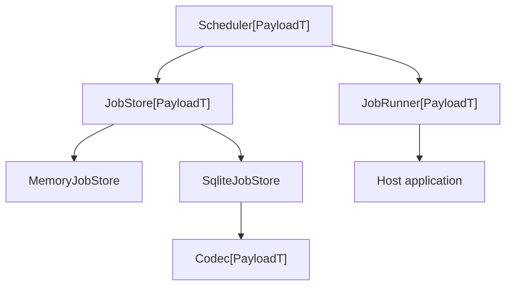

# scheduler

`scheduler` is a small, in-memory async scheduler. It is independent of agent
runtimes, web frameworks, persistence layers, and payload domains.

The package provides three triggers:

```python
Trigger = At | Interval | Cron
```

Payloads are generic and remain strongly typed from registration through
execution. The host application owns their meaning:

```python
from dataclasses import dataclass
from datetime import timedelta

from scheduler import MemoryJobStore, ScheduledRun, Scheduler


@dataclass(frozen=True, slots=True)
class AgentWork:
    agent_id: str
    prompt: str


async def run_agent(run: ScheduledRun[AgentWork]) -> None:
    work = run.payload
    await agent_runtime.run(agent_id=work.agent_id, prompt=work.prompt)


scheduler = Scheduler(run_agent, MemoryJobStore[AgentWork]())
await scheduler.interval(
    every=timedelta(minutes=30),
    payload=AgentWork(
        agent_id="cara",
        prompt="Run your heartbeat.",
    ),
    name="heartbeat",
)
```

The scheduler itself only sees an opaque `AgentWork` value. A different host
can use `Scheduler[Email]`, `Scheduler[Command]`, or any other concrete type
without changing the library.

## Architecture



The scheduler coordinates time and execution. It does not know how jobs are
stored or what their payload means:

- `JobStore[PayloadT]` owns asynchronous add, update, remove, get, and list
  operations.
- `JobRunner[PayloadT]` translates a due `ScheduledRun` into host behavior.
- `Codec[PayloadT]` belongs to a serialized store and only translates the
  host-owned payload. Trigger serialization remains the store's responsibility.

`MemoryJobStore` is useful for tests and ephemeral processes:

```python
store = MemoryJobStore[AgentWork]()
scheduler = Scheduler(run_agent, store)
```

For process-restart persistence, inject a `SqliteJobStore`:

```python
import json
from dataclasses import asdict
from pathlib import Path

from scheduler import SqliteJobStore


class AgentWorkCodec:
    def encode(self, value: AgentWork) -> str:
        return json.dumps(asdict(value))

    def decode(self, value: str) -> AgentWork:
        return AgentWork(**json.loads(value))


store = SqliteJobStore(
    Path("scheduler.db"),
    payload_codec=AgentWorkCodec(),
)
scheduler = Scheduler(run_agent, store)
```

The SQLite schema stores `id`, `name`, `trigger_kind`, JSON `trigger_data`, the
codec-produced `payload`, `created_at`, and `next_run_at`. `start()` reloads all
jobs from the store. Recurring jobs advance and persist `next_run_at` after each
run, so an interval keeps its original cadence across restarts instead of being
anchored to the restart time.

An `At` job is removed after its run finishes. Stopping the scheduler only
cancels in-process tasks; it does not remove persisted jobs.

## API

`Scheduler.schedule()` accepts an `At`, `Interval`, or `Cron` trigger directly.
The convenience methods mirror those trigger types:

```python
await scheduler.at(when, payload=payload)
await scheduler.interval(every=timedelta(minutes=5), payload=payload)
await scheduler.cron(
    expression="0 7 * * 1-5",
    timezone="Europe/Berlin",
    payload=payload,
)
```

All methods return `ScheduledJob[PayloadT]`. The execution callback receives a
`ScheduledRun[PayloadT]` containing the job ID, trigger kind, intended execution
time, name, and the same typed payload.

## Examples

- [`examples/quickstart.py`](examples/quickstart.py) is a short, executable demo
  with an interval and a one-shot `At` job.
- [`examples/long_running.py`](examples/long_running.py) demonstrates how an
  agent-specific payload and adapter stay in the host application.
- [`examples/sqlite_persistence.py`](examples/sqlite_persistence.py) shows a
  persistent store with a host-owned JSON payload codec.

Run the quickstart from the workspace root:

```shell
uv run --package scheduler python scheduler/examples/quickstart.py
```

## Behavior

- `At` runs once at a timezone-aware `datetime`. Overdue jobs run as soon as
  the scheduler starts.
- `Interval` repeats at a fixed interval. Its first run happens immediately by
  default; pass `run_immediately=False` to wait for one interval.
- `Cron` uses a standard five-field expression and an IANA timezone.
- Different jobs may run concurrently. A single recurring job never overlaps
  with itself, and missed occurrences are skipped rather than replayed.
- A failed run is logged and does not stop later recurring runs.
- Job lifetime is controlled by the injected store. `MemoryJobStore` is useful
  for tests and ephemeral processes.

## Delivery semantics

The current implementation targets one scheduler process per job database. It
persists the next run after the runner returns. If the process exits during a
run, that occurrence remains due and may be delivered again after restart. This
at-least-once bias avoids silently losing work.

Multiple scheduler processes can open the same SQLite database, but V1 does not
claim or lease due jobs. Running active schedulers against the same jobs can
therefore execute them more than once. Cross-process coordination can be added
later at the `JobStore` boundary without coupling it to payloads or runners.
